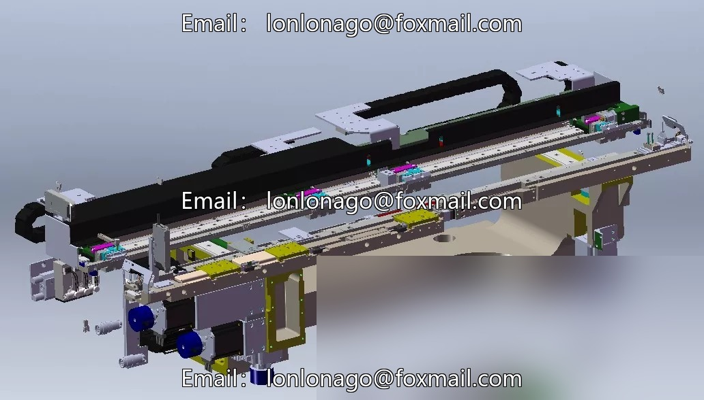
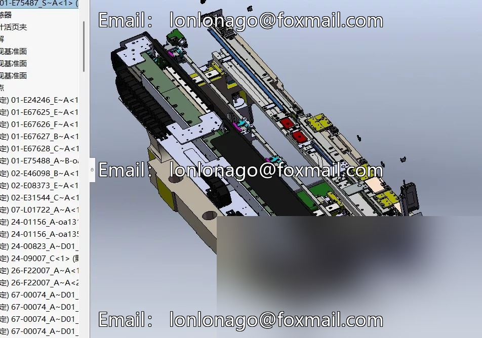
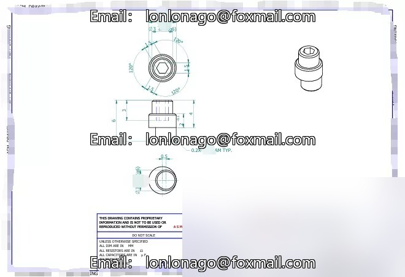
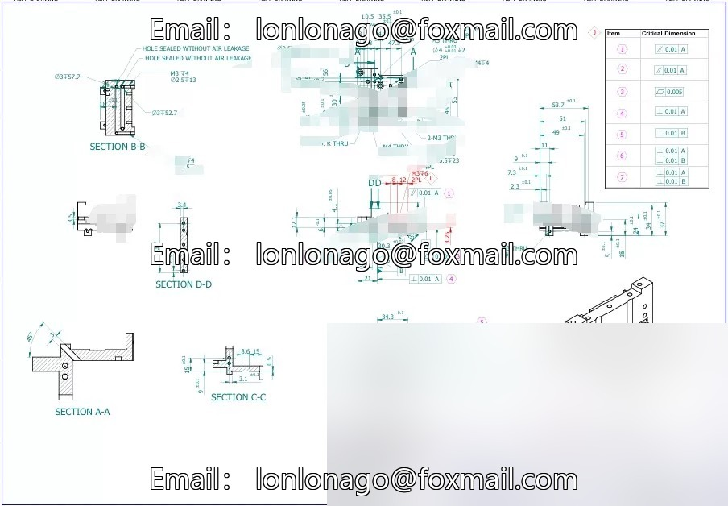

# The drawing for the track transmission component of the ADR32i solid crystal machine

## Body

Proofgrid machine AD832i orbital transmission component drawing material: proofgrid machine ASM 832i orbital detailed 3D and 2D drawings (source archive engineering drawings PDF! Each part has!), scarce materials! Extremely valuable for research and learning.
will not be refunded or exchanged after sale.

The drawing materials cover the solid-crystal machine AD832i track transfer components, including 3D and 2D drawings, source engineering files, and a part list with dimension parameters.

<!-- AI_ENRICHED -->

## Images

## Payment

Here is a pay link on Stripe ( https://buy.stripe.com/3cs8yP7sY87d0vu9AB ). Please contact me lonlonago@foxmail.com after funding $89, and I will send you a complete data files , thank you!

